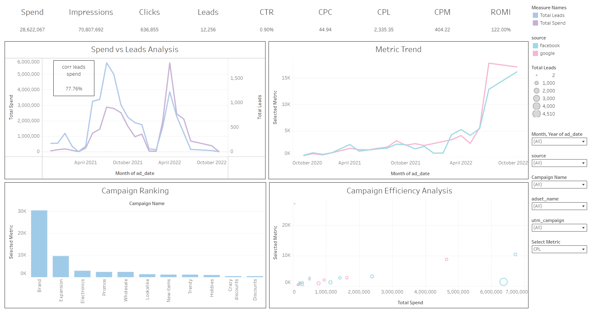

# Marketing_Campaign_Performance_Dashboard-
Analyzed advertising campaign performance. Prepared an analytical dataset using SQL and developed  an interactive dashboard in Tableau Public to evaluate key marketing metrics and campaign effectiveness. 
Tools: SQL, Tableau Public. 
# My tasks: 
- Data processing and preparation in SQL (JOIN, aggregation, data cleaning)
- Creating a unified analytical dataset
- Calculating marketing metrics (CTR, CPC, CPM, CPL, ROMI, Conversion Rate)
- Creating calculated fields and LOD expressions in Tableau
- Developing an interactive dashboard with KPIs, filters, and visualizations 
# Result: 
Created an interactive marketing dashboard in Tableau Public, analyzed advertising campaign performance 
based on key metrics, and prepared visualizations to support business decision-making.
[Link to the dashboard](https://public.tableau.com/views/Project2Tableau_17830044626760/MarketingPerformanceDashboard?:language=en-US&:sid=&:redirect=auth&:display_count=n&:origin=viz_share_link)

